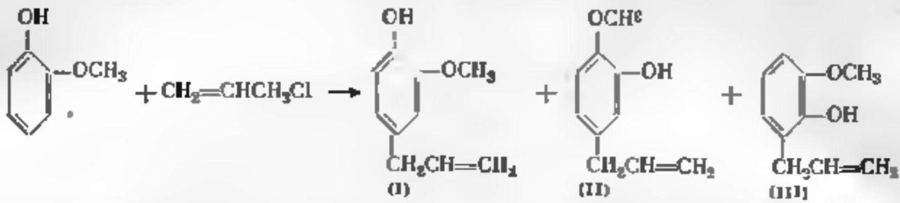

провсходело в незначительной мере. В развитие этих работ нами пред- привято нзучение аллялирования фенольных соединений хлористым аллялом[].

Конденсации галопдных аллллов с ароматическими углеводородами в присутствни кисых каталиаатаров исследовалпсь довольно шпроно. Кислоты $\{ \mathbf { H _ { z } S O _ { \mathbf { { z } } } } _ { }$ НF) направляют взаимодействце по двойной связи, образуются талопдалкилбензолы При пспользовании галопдных солей (АїСі, п др.) обычно ревгируют обе функциовальные группы, конечнымп продуктами являются диарилпрошаны.

Реакции галоцдвых аллилов с фенолами и пх эфиражи мало изучены. Отмечается образованце аллшлвератрола при действии їюдистого алзила на вератрол в присутсташи цинковой пылй []. При конденсациц хлори- стаго аллила с анизолом с помощью хлорного железа в очень мягких условHях $( - 2 1 , - 1 6 ^ { \circ } )$ полученв-хлорпрошланизоя $( \Im \mathcal { E } ^ { \mathbb { P } _ { 6 } ^ { \prime } } )$ 7 соединений не вщделено[].

Используя в качестве каталшзатора медь, мы стрезились селективно напранить реакцию по галоиду для\_ введенпя в молекулы фенольных со- единевей азлильной групшпровки. Многие аллиипрошзводные феколов и эфиров фенолов отиосятся к группе ценных дуистых веществ раститель- ного происхождения. Применяемый нами способ предполагает разработку простаго, однотипного метода пх сиптеза ].

При аллплированпи гваякола рассштывали выделить в качестве основвого продуктв звгснол (I).

Впервые для его получещця Кляйзен вретложил б-стадайный метод синтеза на оспове гваякола ["]. Выход загецола (I) па взятый гваякол сотавхял I". Брюсова и Пофре [] получиш звиеии (I) в смеси с ха- вибетолом (ПI), о-энгенолом (1її) и эфирными продуктами путв каталп- тической взомерцзациш аллилового эфира гваякола, выход фенольной $2 0 - 2 2 \%$ Позже зти результаты быи уточнены и указан бодее низкий выход []. При попытке прямого алшлировапия гваякола алаи- ловым спиртом в присутствиш вскаинта получено $1 . 4 ^ { \mathrm { ~ D ~ } _ { 0 } ^ { \circ } }$ авгенола (I) 11 4.42% изомерных соедпнений [%].

Аллшлирование тваякола ироводилось нами в присутствши раэных фор медлого каталпаатора: продажного порошка, отвечающего ту-44-54. медной бронзы (Кальбаум) и порошка медц, получаемого восстановлс- нцем из раствора мсдного кулороса цинковой пылью.

Ранее намш псследовалось взияние па ход процесса соотнопений реа- гентов, времепи, тамшературы. Лучшис результаты дало использованне З-кратного избытка ароматического комповента и продажного медного порошка в температурном интервале $8 7 - 1 1 5 ^ { \circ } [ ^ { \circ } ] .$ В этих условиях глав- ным напраалением реакциш было аллялпровонце.

В небольшом количестве твкже выделялшсь хлорсодержещие соеди- неншя и аллиловые эфиры гваякола и эвгенода. В гатовдсодержащой фракции обнарукец в-хлордигидроэвгевол. Он образуется в реаультата прпсоедпнения присутствующего в рвакционной смесц хлористого водо- рода к эвгенолу, что подтверждено акспериментально.\*